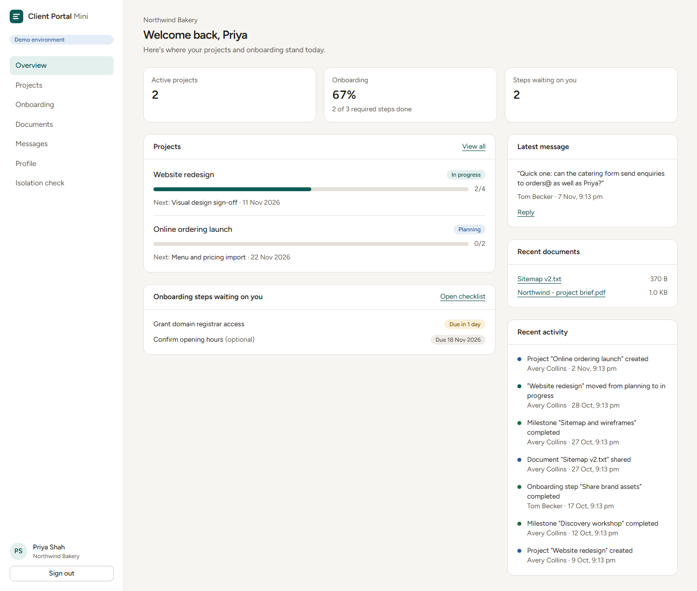

# Client Portal Mini

A multi-tenant client portal for a digital agency. Clients follow their projects, complete
onboarding, download shared files and message the agency. The agency manages every client from one
place.

**Tenant isolation is enforced by PostgreSQL row-level security**, so a client can't see another
client's data even by editing a request. The app includes a page that proves it live.



> **Live demo:** https://client-portal-mini.vercel.app (one-click demo sign-in on the landing page).
> **Status:** portfolio project. All data is synthetic.

## Try it

| Account | Email | Sees |
|---|---|---|
| Agency admin | `portal-admin@example.com` | every client |
| Client A (Northwind Bakery) | `portal-client-a@example.com` | Northwind only |
| Client B (Harbour Physio) | `portal-client-b@example.com` | Harbour only |

Password for all: `DemoPortal!2026`. The landing page also has one-click sign-in buttons.

Things to try:
1. **As Client A**, open **Isolation check** and run it. Seven real requests target Client B's
   records by id, and each one is blocked. Then open the Client B project URL shown on the page:
   it returns 404.
2. **As the admin**, create a project, add milestones, upload a file (try renaming a `.exe` to
   `.pdf`), and invite a new client user. The demo shows you the link instead of emailing it.
3. **As Client A**, tick off an onboarding step, download a document and send a message.
4. **As the admin**, use **Reset demo data** to restore everything.

## Features

- **Auth:** email/password, password reset (PKCE), protected routes, roles (admin / client),
  invitation links.
- **Dashboards:** client overview (projects, onboarding progress, waiting steps, documents,
  activity) and agency overview (all clients, overdue steps, upcoming milestones, client messages).
- **Clients:** organizations, members, single-use invitation links, member removal.
- **Projects:** status, dates, milestones, and a trigger-written history.
- **Onboarding:** per-client configurable checklist, due dates, required vs optional, progress.
- **Documents:** private Supabase Storage, type and size validation (including magic bytes),
  internal vs shared visibility, 60-second signed download links.
- **Messaging:** one append-only thread per organization.
- **Accessibility:** semantic landmarks, labelled fields with linked errors, live regions, visible
  focus, skip link, and keyboard-operable controls. Checked with axe in CI.

Screenshots: [landing](docs/screenshots/01-landing.png) ·
[isolation check](docs/screenshots/03-isolation-check.png) ·
[onboarding](docs/screenshots/04-onboarding.png) ·
[admin dashboard](docs/screenshots/05-admin-dashboard.png) ·
[documents](docs/screenshots/06-admin-documents.png) ·
[mobile](docs/screenshots/07-mobile-dashboard.png)

## Tech stack

Next.js 16 (App Router, Server Components, Server Actions) · React 19 · TypeScript (strict, with
`noUncheckedIndexedAccess`) · Tailwind CSS 4 · Supabase (Auth, Postgres + RLS, Storage) via
`@supabase/ssr` · Zod 4 · pgTAP · Vitest · Playwright + axe · GitHub Actions · Vercel.

## Getting started

Prerequisites: Node 24, Docker (for the local Supabase stack).

```bash
npm install
npx supabase start            # starts Postgres, Auth, Storage locally; applies migrations + seed
cp .env.example .env.local    # paste the PUBLISHABLE_KEY printed by `npx supabase status`
npm run db:seed-storage       # uploads the sample files as the demo admin
npm run dev                   # http://localhost:3000
```

### Environment variables

| Name | Required | Notes |
|---|---|---|
| `NEXT_PUBLIC_SUPABASE_URL` | yes | `http://127.0.0.1:54321` locally |
| `NEXT_PUBLIC_SUPABASE_PUBLISHABLE_KEY` | yes | publishable (anon) key. **Never** the service-role key. |
| `NEXT_PUBLIC_SITE_URL` | yes | base URL for reset and invite links |
| `NEXT_PUBLIC_DEMO_MODE` | no | `true` shows demo sign-in and the reset control |

The app needs **no server secrets**.

### Database

- Migrations: `supabase/migrations/` (applied by `supabase start` / `supabase db reset`).
- Reset local data: `npm run db:reset`.
- Regenerate types after schema changes: `npm run db:types`.
- Deploying to a hosted project: [docs/DEPLOYMENT.md](docs/DEPLOYMENT.md).

## Testing

| Command | What it covers | Last local run (2026-11-08) |
|---|---|---|
| `npm run test:db` | pgTAP: RLS for every role and operation, grants, composite FKs, invitations, reset scope | 79 passed |
| `npm run test:unit` | Zod schemas, file signature checks, redirects, dates and time zones, error mapping | 43 passed |
| `npm run test:integration` | supabase-js over HTTP with real JWTs: id-swap attacks, storage permissions, invitation and workflow paths | 22 passed |
| `npm run test:e2e` | Playwright on a production build: auth, isolation page, URL tampering, workflows, uploads and downloads, axe scans, mobile nav | 24 passed |
| `npm run lint` / `npm run typecheck` | ESLint, `tsc --noEmit` | clean |

`test:db`, `test:integration` and `test:e2e` need the local stack running. CI
(`.github/workflows/ci.yml`) runs everything on each push and PR, and passes on GitHub Actions.

## Security

See [docs/SECURITY.md](docs/SECURITY.md), which covers the layers of defence, every privileged
function and why it exists, existence-leak prevention, and the shared-project isolation. Key
points:
- RLS on every table.
- Column-level grants.
- Composite FKs.
- A private bucket whose read policy mirrors document RLS.
- No service-role key in the app.

## Architecture and decisions

- [docs/ARCHITECTURE.md](docs/ARCHITECTURE.md): diagram, data model, routes, layout.
- [docs/adr/0001-no-server-cache.md](docs/adr/0001-no-server-cache.md): why Cache Components is off.
- [docs/case-studies/01-reset-fails-only-over-http.md](docs/case-studies/01-reset-fails-only-over-http.md):
  two real bugs found during development, with root causes and regression tests.

## Troubleshooting

| Symptom | Fix |
|---|---|
| `ZodError` on start-up about `NEXT_PUBLIC_SUPABASE_*` | Create `.env.local` from `.env.example`. |
| Login works but every page is empty | The `portal` schema isn't exposed. Check `[api] schemas` in `supabase/config.toml` (local) or *Data API → Exposed schemas* (hosted). |
| Documents list but downloads 404 | Run `npm run db:seed-storage` (DB reset doesn't restore storage objects). |
| "DELETE requires a WHERE clause" | Every mass `UPDATE`/`DELETE` reachable from the API needs an explicit `WHERE`. See case study 1. |
| Password reset link goes to "Link expired" | Add `<site>/auth/confirm` to the Auth redirect allow-list, and open the link in the same browser that requested it (PKCE). |
| Port 54321 is in use | Another Supabase stack is running: `npx supabase stop --project-id <other>`. |

## Future improvements

Realtime message updates, email notifications through a transactional provider, file versioning,
per-project threads, an audit export, two-factor auth for admins, and a nightly scheduled demo
reset.
